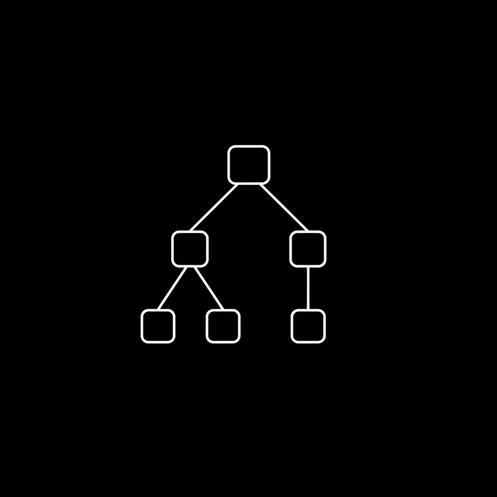

# Programación de Sistemas (Compiladores)

La programación de sistemas es un área de la computación dedicada al desarrollo de software que permite el funcionamiento y la interacción entre los programas y los recursos de un sistema computacional. Comprende herramientas como compiladores, intérpretes, sistemas operativos y otros programas que proporcionan servicios fundamentales para la ejecución de aplicaciones. Su estudio permite comprender cómo se procesan los lenguajes de programación y cómo se transforman las instrucciones escritas por las personas en operaciones ejecutables por una computadora.

Este curso ofrece una introducción a la construcción de procesadores de lenguajes de programación, abordando las principales etapas del diseño e implementación de un compilador. A lo largo del semestre, las personas estudiantes explorarán el análisis léxico, sintáctico y semántico, así como los fundamentos de la generación de código. Mediante el desarrollo progresivo de un procesador para el lenguaje IMP, aplicarán conceptos de gramáticas, autómatas, estructuras de datos y algoritmos, fortaleciendo su comprensión sobre el funcionamiento interno de los lenguajes de programación y su importancia en la ingeniería de software.

## Notas de clase

<ol>
   <li>
	   <a href="https://drive.google.com/file/d/19PzHrEmHScHcsPY-ci-hwYNmh-MEbqIz/view?usp=drive_link" target="_blank">
	   	Panorama de la programación de sistemas
	   </a>
   </li>
	<li>
	   <a href="https://drive.google.com/file/d/1yw0sCa3zMJfkOd6FMMHqJJm8Ww3v2YQ9/view?usp=drive_link" target="_blank">
	   	Estructura y fases de un compilador
	   </a>
   </li>
	<li>
	   <a href="https://drive.google.com/file/d/1ZtrhB6N9IYb5O3v5WvJ16qJwPsIYRwog/view?usp=drive_link" target="_blank">
	   	Fundamentos del análisis léxico
	   </a>
   </li>
	<li>
	   <a href="https://drive.google.com/file/d/1Zf6qW_nTfYG4KYRS5oY8Qvkk0JqFcjq1/view?usp=drive_link" target="_blank">
	   	Expresiones regulares y autómatas finitos
	   </a>
   </li>
	<li>
	   <a href="https://drive.google.com/file/d/1ddAIRQzxwoIwH68PxPNKdu-gIhfUdYqf/view?usp=drive_link" target="_blank">
	   	Diseño e implementación del analizador léxico
	   </a>
   </li>
	<li>
	   <a href="https://drive.google.com/file/d/1cZ1EmSskude4efcPBajzVJikXzbJ4jcG/view?usp=drive_link" target="_blank">
	   	Gramáticas libres de contexto y estructura sintáctica
	   </a>
   </li>
	<li>
	   <a href="https://drive.google.com/file/d/1AbtXOTEk9OIU5jJ-7OcIA4ejYRWHqjne/view?usp=drive_link" target="_blank">
	   	Análisis sintáctico descendente
	   </a>
   </li>
	<li>
	   <a href="https://drive.google.com/file/d/1PvihPbCczW6glVXJJqgLf0Thn8MTYqKy/view?usp=drive_link" target="_blank">
	   	Análisis sintáctico ascendente y manejo de errores
	   </a>
   </li>
	<li>
	   <a href="https://drive.google.com/file/d/1B0Oyq0nj7ayFDorGAnWsryGY4KIGdGSb/view?usp=drive_link" target="_blank">
	   	Traducción dirigida por la sintaxis
	   </a>
   </li>
	<li>
	   <a href="https://drive.google.com/file/d/1wtYCflThqbE63L4ya2ViDwqEEffEkTjf/view?usp=drive_link" target="_blank">
	   	Juicios y verificación de tipos para IMP
	   </a>
   </li>
</ol>

*Anexos*

<ul>
  <li>
	   <a href="https://drive.google.com/file/d/1X7ty966orFo7FLkGAQzb4tm18pVYr6FX/view?usp=drive_link" target="_blank">
	   	Análisis sintáctico descendente (Ejercicios resueltos)
	   </a>
   </li>
<li>
	   <a href="https://drive.google.com/file/d/1t3J-AgZL-Yk61-joUtnv_jlJml4hYzru/view?usp=drive_link" target="_blank">
	   	Análisis sintáctico ascendente (Ejercicios resueltos)
	   </a>
   </li>
</ul>
